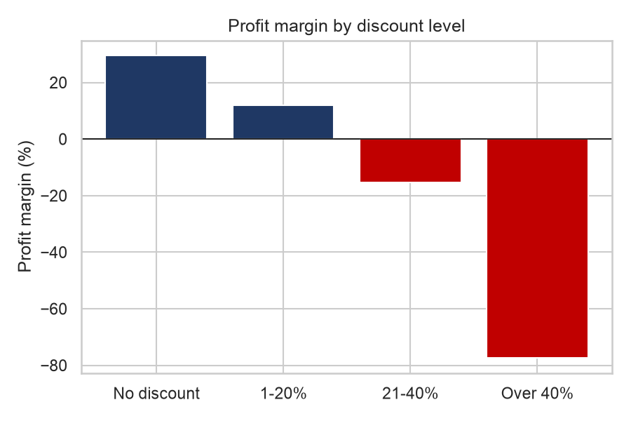
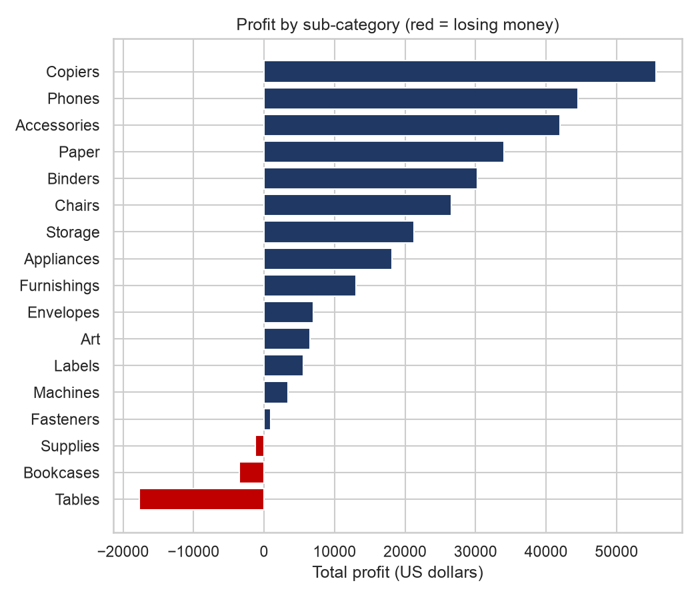
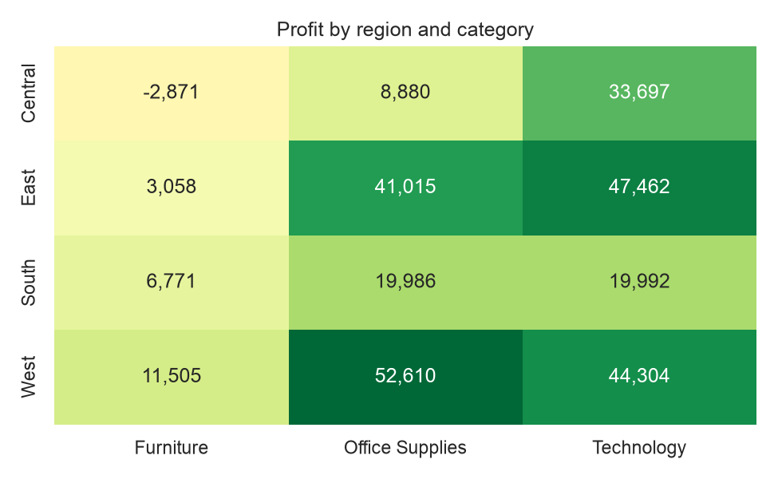
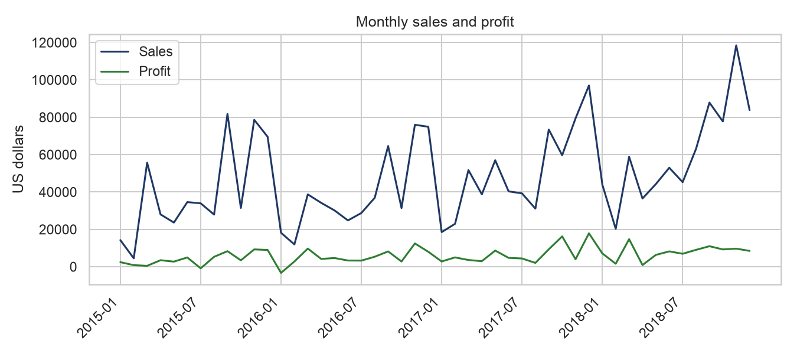

# E-commerce Sales & Profitability Analysis (Python + SQL + Interactive Dashboard)

Where does a US retailer make money, where does it lose it, and why?

**Tools:** Python, SQL (SQLite: JOINs, CTEs, window functions), Pandas, Matplotlib, Seaborn, Plotly
**Dataset:** Superstore sample dataset: 9,994 order lines, 793 customers, Jan 2015 to Dec 2018, plus tables of regional managers and returned orders.

## Interactive dashboard
Open `outputs/dashboard.html` in any browser (no internet needed). Filter by **year, region and category**; the KPIs and all 5 charts update instantly.

## Headline numbers
| Metric | Value |
|---|---|
| Total sales | $2,296,919 |
| Total profit | $286,409 (12.5% margin) |
| Orders / customers | 5,009 / 793 |
| Average order value | $459 |

## Key findings

**1. Big discounts destroy profit.** Order lines with no discount earn a 29.5% margin and 1-20% discounts earn 11.9%. Discounts of 21-40% run at a **-15.3%** margin, and discounts over 40% at **-77.4%**. Lines discounted above 20% lost about **$135K** in total.



**2. Furniture is barely profitable.** Furniture has a 2.5% margin against about 17% for Technology and Office Supplies. Tables (-$17.7K, -8.6% margin), Bookcases (-$3.5K) and Supplies (-$1.2K) all lose money.



**3. The Central region is the weakest, and discounting explains why.** Central has a 7.9% margin against 14.9% in the West. It gives an average discount of 24.0% (West: 10.9%), and 27.7% of its order lines are discounted above 20% (West: 3.7%).



**4. Several big states lose money.** Texas (-$25.7K), Ohio (-$17.0K), Pennsylvania (-$15.6K), Illinois (-$12.6K) and North Carolina (-$7.5K) are unprofitable, even though Texas and Pennsylvania are top-5 states by sales.

**5. Growth is strong, and sales peak late in the year.** Sales grew 29.5% in 2017 and 20.4% in 2018, after a small dip of 2.8% in 2016. On average, November, December and September are the biggest months.



**6. Other facts.** About 5.9% of orders were returned (296 of 5,009); Technology (8.0%) and Furniture (7.7%) are returned most. The top 20% of customers make 48% of sales, so sales are not very concentrated. Standard Class shipping takes 5.0 days on average.

## Recommendations
1. Cap discounts at 20%. Approval should be needed above that level, because every band above 20% loses money.
2. Review pricing and supplier costs for Tables and Bookcases, or drop the worst products (for example the Cubify CubeX 3D printers).
3. Investigate the Central region's discount policy and the unprofitable states (Texas, Ohio, Pennsylvania, Illinois).
4. Plan stock and marketing around the September to December peak.

## What is in this folder
| File / folder | What it is |
|---|---|
| `run_analysis.py` | The full analysis in one script. Run this. |
| `sales_analysis.ipynb` | The same analysis as a Jupyter notebook with charts inline |
| `dashboard_template.html` | The web page template that the script fills with data to make the dashboard |
| `data/superstore_raw.csv` | The dataset |
| `outputs/` | Dashboard, charts, SQL result tables (`sql_*.csv`), SQLite database, and `summary.md` |
| `requirements.txt` | The Python libraries needed |

## How to run
```bash
python3 -m venv venv
source venv/bin/activate
pip install -r requirements.txt
python run_analysis.py
open outputs/dashboard.html      # on Mac
```

## Method, in short
1. **Split:** the raw CSV is really three tables stacked together (orders, managers, returns), so I separated them.
2. **Clean:** restored leading zeros on postal codes, filled 11 missing Burlington, VT codes, removed 1 duplicate line, checked dates, and de-duplicated 800 return records to 296 unique orders.
3. **SQL:** loaded the tables into SQLite and wrote 15 queries using `GROUP BY`, `HAVING`, `CASE WHEN`, `JOIN` / `LEFT JOIN`, CTEs and window functions (`LAG`, `ROW_NUMBER`, running `SUM() OVER`).
4. **Visualise:** 5 static charts (Matplotlib and Seaborn) and one interactive dashboard (Plotly).
5. **Verify:** the SQL totals were cross-checked against Pandas and against the dashboard's own calculations.

## Limitations
- This is a well-known public sample dataset, so the findings describe this data and not a real company.
- The data shows that discounts and losses go together. It does not prove that discounts alone cause the losses, because other costs are not in the data.
- Profit is taken as given in the dataset; cost details are not available.
